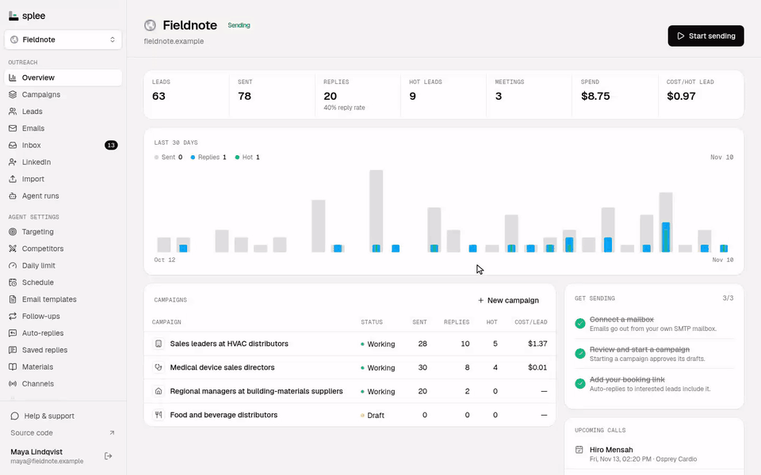
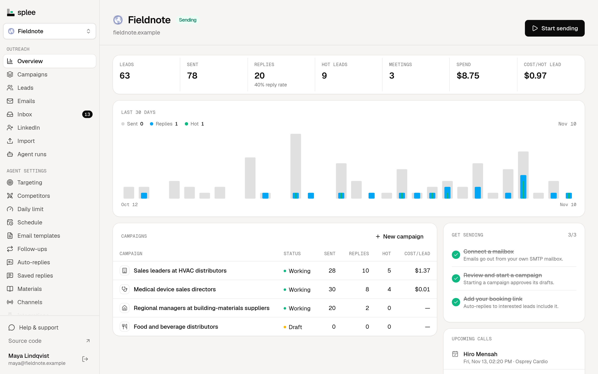
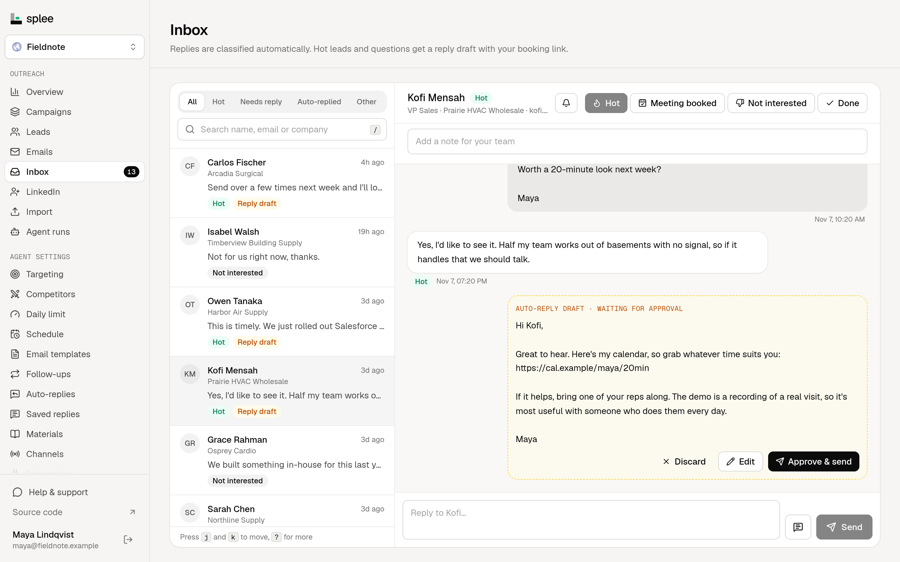
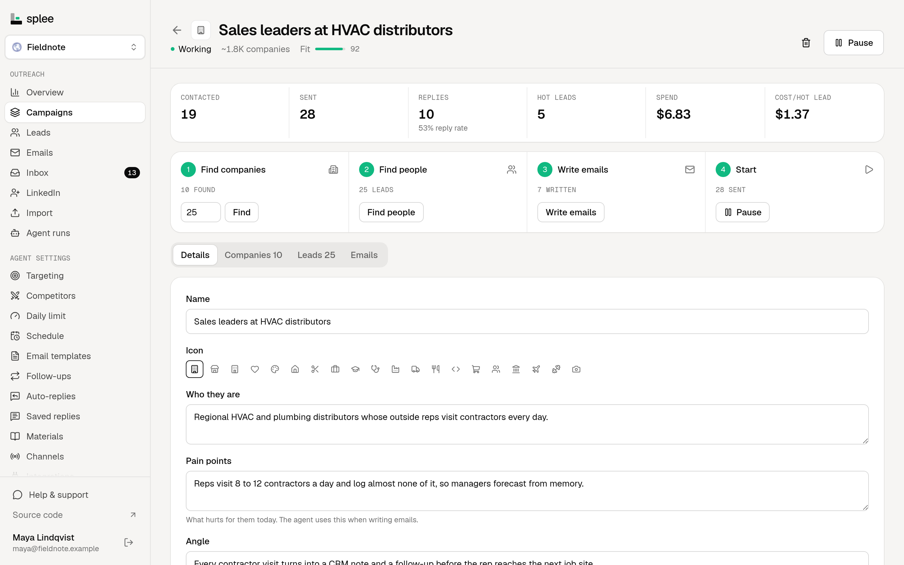
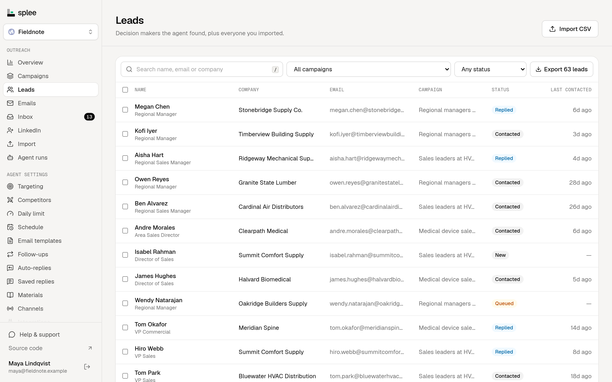

# Splee: open-source AI SDR and cold email platform

**Paste your website. Splee finds your buyers, writes each one a personal cold email, sends it from your own mailbox and answers the replies.**



[Watch it in full quality (mp4)](docs/media/demo.mp4)

<table>
  <tr>
    <td width="50%"><br><sub><b>Overview.</b> Replies, meetings and the cost of each hot lead.</sub></td>
    <td width="50%"><br><sub><b>Inbox.</b> Every hot reply gets an answer drafted.</sub></td>
  </tr>
  <tr>
    <td width="50%"><br><sub><b>Campaigns.</b> Find companies, find people, write, send.</sub></td>
    <td width="50%"><br><sub><b>Leads.</b> Every decision maker and where they stand.</sub></td>
  </tr>
</table>

<sub>The screenshots show Fieldnote, a made-up company with made-up leads.</sub>

Splee is a free, open-source AI SDR (an AI outbound agent) that you host yourself, modelled on [explee.com](https://explee.com). You paste your website. A Claude agent then researches your company, competitors and buyer segments, and finds matching companies and their decision makers on the web. It writes a personal cold email to each person and sends them from your own mailboxes within a daily email limit. It also reads the replies over IMAP and answers interested leads with your booking link.

It runs on your machine or server, with your own Claude subscription and mailboxes. Nothing goes through a third-party outbound platform.

## How Splee compares

**Is Splee an open-source alternative to Explee?** Yes. Explee is a hosted AI cold email agent, and Splee does the same job from your own server: you paste a website and get buyer segments, leads, written emails and answered replies. Splee is free under the AGPL and sends from your own mailboxes.

**Can it replace Instantly, Smartlead or lemlist?** Yes. As self-hosted cold email software, Splee rotates mailboxes under daily limits, warms them up, threads follow-ups, A/B tests angles and shows every reply in one inbox. It also finds the leads and writes the emails. Paste an API key from any of the three and your campaigns, leads and blocklist come over.

**Is it an AI SDR?** Yes. The agent researches your market, finds decision makers, writes to each one, classifies the replies and answers interested leads with your booking link. You choose whether it waits for your approval on every draft.

**Is it an Apollo alternative for lead generation?** For finding leads and running sequences, yes. Splee ships no contact database. The agent finds companies and people on the web and through LinkedIn people search, the email finders you connect fill in addresses, and you can load every business with a website in a country from Overture Maps' open data.

**Does it work from Claude, ChatGPT, Claude Code or Cursor?** Yes. Splee's MCP server lets you search companies, start campaigns, find people and approve emails from a chat. ChatGPT and Claude.ai connect with its URL and a sign-in, Claude Code and Cursor with an API key.

## Features

- **Research.** It profiles your company, maps competitors, proposes buyer segments as campaigns, finds companies and decision makers, through LinkedIn people search when Unipile is connected, and writes personal emails and LinkedIn sequences. Each campaign writes to every lead in their own language, from the one set on them, their country or their company's website, or in one language you pick from 32, with the formal address each language expects, and drafted replies answer in the language the lead wrote in. Every day it also reads your companies' public job boards (Greenhouse, Lever, Ashby, Workable and Recruitee) and flags the ones hiring for the roles you sell to, so the email can open with the job post. With Unipile connected, it also watches everyone who bought, booked a meeting or replied with interest, plus past customers you add by hand or CSV, and when one of them moves to a new company it makes them a lead there, tells their old lead's owner and lets the first email mention the history. Each week it also checks your companies for news: Form D filings with the SEC when a US company raises money, and posts on each company's own blog about funding, launches, acquisitions, new offices or new leaders, so the score and the first email can mention them. It also checks each company's homepage and DNS for about 160 common tools, like HubSpot, Intercom or Shopify, so you can find companies that use a tool or a competitor's, and the email can mention the ones you pick. Give it a few companies that bought from you, by default the ones you won deals with, and it ranks the company database by what they have in common, like industry, tools, hiring and region, with the reasons each one matched, without Claude. Ask a question about every company, like "Do they sell to hospitals?" or "Which CRM do they use?", and the agent answers it for each one from its website and the web, with the page that shows it, as a column on the Companies page you can filter by and the writer can open emails with. Each lead and company gets a 0-100 score from how well it fits your targeting and what it did lately, like hiring for the roles you sell to, reading your pricing page or replying with a question, so the Leads and Companies pages, autopilot and the writer start with the likeliest buyers, and each score lists its reasons. With your own Google Maps key, the Companies page also finds local businesses like dentists, gyms or restaurants by category and city, over up to 20 cities or ZIP codes at once, and adding them to a campaign reads each one's website for a contact address, without Claude. Leads that come without an email, like LinkedIn people search's, get one from the connected email finders, then from the common address patterns checked with the verifier, without spending Claude tokens. A worker searches up to 200 new leads an hour per organization, and "Find emails" on the Leads page searches the ones you pick. Every run streams its progress live and can be cancelled.
- **Website visitors.** Add one script tag to your site and the Companies page shows which companies visit it, the pages they read and how they first found you, so you can add them to a campaign. Each visitor's IP is looked up once a month, through IPinfo when you set a token, else its reverse DNS and RDAP record, and home, mobile, cloud and VPN connections are left out. A company in a campaign, or one that read 3 pages in a day, opening a page you mark, like /pricing, pings your chat once a day.
- **Website chat.** One more script tag adds a chat to your site that answers visitors from your product description, materials and FAQ, within daily and monthly limits you set, asks interested visitors for their email, makes them hot leads and lets you take over a conversation from the Inbox.
- **Sending.** It sends from any SMTP mailbox, rotating mailboxes under per-mailbox daily limits, and each mailbox can use its own signature and booking link. Google Workspace, Gmail, Microsoft 365 and Outlook.com mailboxes can connect by signing in instead of with an app password, once you set up the sign-in apps below. Sending respects each project's time zone, send days and hours. Follow-ups thread under the first email. Each campaign can track link clicks, on by default, and opens, off by default since the pixel can hurt inbox placement, from your own tracking subdomain like track.yourdomain.com, which Splee sets up on domains it bought. Security scanners and link previews are left out of the counts, and real clicks raise the lead's score and show on their timeline and the Analytics page. Turn on personal pages for a campaign and each first email links to a short page written for that lead, with a headline about their company, three ways you'd help them, proof from your materials and your booking link, and a lead who opens it gets a higher score and a ping in your chats. Warmup has the mailboxes on your Splee email each other short business-style messages, starting at 2 a day and adding 2 a day up to 40. They answer some of them, flag some as important and move any that land in spam back to the inbox, and the Mailboxes page shows each mailbox's inbox placement. A new mailbox holds its campaigns for the first 14 days of warmup. You can choose to review every draft or approve whole campaigns. A campaign can A/B test up to four angles, each a short brief for the writer on what the email leads with, how it asks for a reply and how its subject reads. New leads take turns between them and keep theirs for follow-ups, and the campaign page shows each angle's sends, replies, hot leads, bounces and unsubscribes and says when a gap is too big to be chance. Turn on auto-pick and once every angle has the sends you set, a clear winner is kept and the others stop getting new leads. Once a campaign has 5 replies, the agent can read them and tell you what gets people to answer, which objections come up and how many replies give each, with an answer you can save as a saved reply, and suggest new pain points or a new angle for the campaign that a click puts in. With your Twilio account connected, a sequence can also text leads that have a phone number, by SMS or WhatsApp, a few days after their first email. The writer keeps each SMS short and plain, signs it with your name and ends the first one with a STOP line where carriers or the law expect it. A WhatsApp text outside the 24 hours after the lead last wrote is your approved template, filled in with the lead's details. Texts follow the same approvals, send days and hours, in the lead's own time zone when their number shows it, up to 50 a day per project unless you change it, and a reply on any channel stops the rest.
- **Domains.** Splee suggests about 20 lookalikes of your domain, like getacme.com or acmehq.com, with Porkbun's price for each. Tick a few, confirm the total and it buys them through your Porkbun account, one at a time and never twice. It then sets each domain's SPF, DMARC and the MX records of your mail provider, and forwards it to your main site. You paste the DKIM key from Google Workspace, Microsoft 365 or Zoho, and Splee adds it and checks the DNS.
- **Autopilot.** Turn it on and Splee keeps every sending campaign stocked with about three days of written emails. It finds companies, starting with the company database, then the people at them, then writes their emails, one run at a time. It stops for the month at a Claude budget and a cap on new leads you set, and tells your team when the budget runs out. Its emails wait for your approval unless you let them go out on their own. The overview shows what it's doing and the month's spend and leads against both limits.
- **Plays.** Set up "when this happens, do that" rules and Splee acts within 5 minutes: when a company raises money, posts a job you watch, has news or visits your site, add it to a campaign and find its people, when a past customer moves to a new company, write them, and when a lead's score reaches a number, tell your chats. Each play acts once per company or lead, up to a daily cap, and the Plays page shows what each one did.
- **Inbox.** It polls IMAP for replies, takes text replies from Twilio, and sorts them into hot, question, not interested, out of office, unsubscribe or bounce. It drafts replies with your booking link, or the mailbox's Splee booking page, and either sends them or holds them for approval. Saved replies drop your usual answers into a reply, with the lead's name and company filled in. A lead who texted back gets your answer by text, on the channel they used.
- **Pipeline.** Teams without a CRM can take hot leads to won or lost in Splee. A hot reply opens a deal and a booked meeting moves it to Meeting booked, and you drag deals between stages you name yourself, or pick a stage on a phone. Each deal has a value, an owner, an expected close date and notes, and the top of the board shows the open and weighted pipeline, what you won this month and your win rate. Deal events go to your webhooks, and the API and MCP server can list, create and move deals. Connect Stripe, Paddle or Lemon Squeezy and a payment from a lead, or anyone at their company, wins their deal with the real amount, while Analytics shows the revenue each campaign brought in and the return on what it cost. A day before each booked call, the agent writes a brief on the lead: who they are, what their company did lately, what was said so far, what to bring up and what to ask, from everything Splee knows, and posts it to your chats and the lead's owner. When an open deal goes 14 days without an email, a call or a stage change, its card says so and the agent drafts a short email in the thread with a reason to answer now, like their company's news or a page of yours they read, for you to approve from the deal or the Emails page. The agent also writes each deal a close plan from the conversation: the steps to a signed deal, theirs and yours, with dates up to the expected close. Share its link and the buyer ticks off their steps on a page of their own, while each step they finish pings your chats and shows on the deal's card. Connect Fireflies, Fathom, Gong or Zoom and after each meeting with a lead the agent writes a summary and next steps, drafts the follow-up email for you to approve and suggests the deal's next stage, which it moves to only when you click.
- **Safety rails.** It keeps a suppression list of emails, domains and phone numbers, takes a number off every list when its owner texts STOP, adds an unsubscribe link and `List-Unsubscribe` header to every outreach email, and handles bounces. A daily email limit per project and per mailbox caps sending, a mailbox that bounces more than 1 in 10 of its leads pauses itself, and the DNS checker covers MX, SPF, DMARC and DKIM. The Deliverability page checks every domain and sending IP on the Spamhaus, SURBL, URIBL, Barracuda and SpamCop blocklists every 6 hours, adds Gmail's reputation and spam rate once you connect Google Postmaster, and holds a mailbox that's at risk from sending until you resume it. With a NeverBounce, MillionVerifier, Hunter, Kickbox, Bouncer, Emailable, Clearout, Reoon, DeBounce, EmailListVerify, Bouncify, QuickEmailVerification, Abstract API, MailboxValidator or MyEmailVerifier key, each address is checked before its first email, and ones that don't exist fail instead of bouncing. Hunter, Findymail, Prospeo, Anymail Finder, LeadMagic, Apollo, Voila Norbert, Skrapp, Lusha, People Data Labs, RocketReach, Snov.io, Dropcontact, ContactOut and Kaspr find emails in the order you pick, skipping one for a while when it runs out of credits or hits its rate limit. Turn on "Find phone numbers too" and the ones that return mobile numbers also fill in a lead's empty phone, never one on the suppression list. An address the email search finds is never set when it or its domain is on the suppression list or another lead already has it, and catch-all domains are skipped rather than guessed.
- **Buying committees.** A lead's window lists everyone you have at their company. Click "Find the rest" and the agent says who decides, who champions it and who has a say, names up to three roles you're missing, like finance or security, and finds people in those roles for the same campaign, so a deal never hangs on one person.
- **Today.** One page lists what's waiting on you across every project: replies to answer, calls due, meetings in the next day with their briefs, drafts to approve and deals gone quiet. Each opens where you act on it, and it shows your leads and unassigned ones unless you pick everyone's.
- **Ask Splee.** Press A in a project and ask about your pipeline in plain words, like "Who replied this week?" or "Which deals are closest to closing?". The agent looks it up with the same read-only tools as the MCP server and answers in a few seconds, with each lead it names opening in its window. It can only read, so it never changes anything.
- **Costs.** Spend, cost per hot lead and cost per meeting add up what Claude Code reports for each agent run and the cost per email you set on each mailbox. On a Claude subscription, the AI part is the equivalent API price. The Analytics page splits them by campaign and date range, next to the period before, with reply rates by campaign, mailbox, follow-up, channel and send time. The API and the MCP tool get_analytics return the same numbers. Agencies can share a project's results with a client through a read-only link, with a weekly or monthly summary email.
- **Integrations.** Hot-lead alerts go out by email or to a Slack, Discord, Microsoft Teams, Google Chat, Telegram, Lark, Feishu, DingTalk, WeCom, Webex, Mattermost, Rocket.Chat, Zulip, Zoho Cliq, Pumble or Flock channel, or as a phone notification through ntfy, Pushover, Gotify or Bark, which also hear about booked meetings and reminders that come due. Calendly, Cal.com, SavvyCal, OnceHub, Zcal, TidyCal, Appointlet and Chili Piper bookings mark the lead Meeting booked on their own. Without one, each mailbox can have a Splee booking page with its working hours, minus the busy times in the owner's Google, Outlook or iCloud calendar. Booking there sends both sides a calendar invite from the mailbox, with links to move or cancel the call, and marks the lead Meeting booked the same way. Inbox reminders show up in Google Calendar, Outlook or Apple Calendar through a private feed. Tally, Typeform, Fillout, Jotform, Paperform, Formbricks, Netlify and Webflow forms add whoever fills them in as a lead. Hot and booked leads go into HubSpot, Salesforce, Zoho CRM, Dynamics 365 Sales, Pipedrive, Attio, Close, folk, Capsule, Brevo, Zendesk Sell, Less Annoying CRM, Salesflare, Affinity, Freshsales, Copper, Insightly, Twenty, a Notion database, an Airtable table, a Baserow, NocoDB, Grist or Teable table, or a self-hosted Twenty, EspoCRM or Odoo, with a note holding their reply, and a BCC address copies every email Splee sends to any CRM that logs email that way. With Twilio connected, sequences can text leads by SMS and WhatsApp from your own numbers. Sequences can also have call steps, which wait on the Calls page for the lead's owner to call them from the browser between 8:00 and 20:00 their time, with the call recorded, summarized from its transcript if you turn that on, and its outcome moving the lead on. With Unipile connected, LinkedIn sequences send themselves from your own LinkedIn account, and "Find people" on the Companies page adds the decision makers LinkedIn finds at the companies you pick. Each campaign can also fill an ad audience on LinkedIn, Google Ads or Meta with the leads it has emailed, synced every hour from hashed addresses and numbers only, so you can show ads to the people you're emailing, and anyone who opts out comes out again. Webhooks to up to 10 endpoints can also get every reply, booked meeting, unsubscribe, bounce, sent email and due follow-up. The Integrations page lists recent deliveries and can resend one. With the Splee Slack app added to a workspace, each project's hot replies post to a channel with the drafted answer, ready to send, edit or snooze, and each morning brings the emails waiting for approval, to approve one by one or a campaign at a time, all from Slack. The Splee browser extension for Chrome, Edge and Firefox adds the person or company you're looking at, on a LinkedIn profile, a LinkedIn company page or any company's website, as a lead in one click. Leads import from CSV or Excel, from a Google Sheet's link, from an Airtable table, from a Notion database, from a Baserow, NocoDB, Grist or Teable table or from Hunter's list of people at a company, and export to CSV. Connect a Google account to keep importing new rows from a Google Sheet every 15 minutes, and to add a row to another sheet for every hot lead, booked meeting and won deal. If you're moving from Instantly, Smartlead or lemlist, paste its API key and pick campaigns: each comes over as a draft with its emails and leads, the people it already emailed and those who replied keep that status, and its bounces, unsubscribes and blocklist go on your do-not-contact list. Zapier, Make and n8n connect with an API key to start a zap, scenario or workflow on a hot reply, a reply, a booked meeting, a status change, a won deal or a new lead, and to add or update leads, set their status or owner and add to the do-not-contact list, with the apps for all three in `integrations/`. A public REST API takes API keys, and Splee's MCP server lets you search companies, start campaigns, find people and approve emails from a chat: ChatGPT and Claude.ai connect with just its URL and a sign-in, Claude Code and Cursor with an API key.
- **Social.** Connect your company's accounts on X, Reddit, Bluesky, Mastodon, Threads, YouTube, Stack Exchange, DEV, Lemmy, Nostr, Tumblr or Hashnode, join Discourse forums, add your own bot to the Discord channels and Telegram groups you pick, or use LinkedIn sending through Unipile, and the agent finds recent threads, notes, messages, articles, videos and open questions where your buyers talk about the problem you solve. It drafts helpful replies that say when they mention your product, plus a few original posts. Each platform gets what it takes: comments on YouTube, answers on the Stack Exchange site you pick, articles only on DEV, comments and articles on Hashnode, and new Discourse topics only in the category you pick for the forum. Tumblr has no replies for apps, so there a reply goes out as a reblog with your comment. You edit, approve or skip each one on the Social page, or write your own, and Splee posts the approved ones from your account, up to 15 a day per account. Lemmy, Tumblr, Discord and Telegram take 10, LinkedIn, Stack Exchange and each Discourse forum 5, DEV 2 articles, and Hashnode 2 articles and 10 comments. Sign in with Facebook (once `META_APP_ID` and `META_APP_SECRET` hold a Meta app with `PUBLIC_URL` + `/api/social/oauth/meta/callback` as its redirect URL) and pick the Pages and linked Instagram business accounts the agent may use, and it answers the comments on their recent posts, saying which commenters are your leads, and drafts Page posts and Instagram posts with a picture, up to 5 posts and 15 answers a day each. Connect your own WordPress, Ghost or Webflow blog and the agent writes articles for it too, up to 2 a week by default, which go in as drafts on the blog or get published once you approve them, as you pick for each blog.
- **Teams.** It has organizations, invites and admin roles. Each lead can have an owner, set by hand or by a project's round robin or the mailbox that emailed it, who gets its hot-lead alerts and a Slack mention, and Inbox, Leads and Pipeline filter to Mine or Unassigned.

## Quick start

You need:

- Docker, for Postgres.
- [Rust](https://rustup.rs) 1.93 or newer.
- Node.js 20 or newer and [pnpm](https://pnpm.io).
- The [Claude Code CLI](https://docs.claude.com/en/docs/claude-code), signed in. Running `claude` in your shell must work.

From the repo root, run each of these in its own terminal:

```sh
docker compose up -d                                  # Postgres on 127.0.0.1:55432 (dev password, loopback only)
(cd backend && cp -n .env.example .env && cargo run)  # API on 127.0.0.1:8787, runs migrations on start
(cd frontend && pnpm install && pnpm dev)             # app on http://localhost:3333
```

Open http://localhost:3333, sign up and paste a website. The first account in an organization is its owner. To fill the company database, add `OPERATOR_EMAILS=<the email you signed up with>` to `backend/.env`, restart the API and load a small country like LU from a project's Companies page.

## Configuration

The backend reads `backend/.env`, and the frontend reads its own environment.

| Variable | Default | What it does |
|---|---|---|
| `DATABASE_URL` | required | Postgres connection string. |
| `APP_SECRET` | required | Encrypts mailbox passwords. Set a long random value (`openssl rand -hex 32`) before you connect a real mailbox, and keep it, because changing it makes the saved passwords unreadable. With an `https://` `PUBLIC_URL` the API won't start on the example value or anything shorter than 32 characters. |
| `PUBLIC_URL` | `http://localhost:3333` | Where the app is served. Used for unsubscribe, invite and inbox links in emails, and as the address ChatGPT and Claude.ai sign in to the MCP server at. An `https://` URL also makes the sign-in cookie HTTPS-only. |
| `UNSUBSCRIBE_URL` | `PUBLIC_URL` | Where unsubscribe links in emails point, when the app itself isn't reachable from the internet. That host must serve `/unsubscribe/<token>` and pass `POST /api/unsubscribe/<token>` to the API. `deploy/unsubscribe-worker` is a Cloudflare Worker that does both and queues each unsubscribe until Splee takes it. |
| `BIND_ADDR` | `127.0.0.1:8787` | Address the API listens on. |
| `AGENT_MODEL` | `claude-sonnet-5-5` | Claude model for every agent run. |
| `AGENT_CONCURRENCY` | `2` | How many agent runs execute at once. |
| `SENDING_ENABLED` | `true` | `false` stops the sender, so approved emails, follow-ups, auto-replies and social posts wait. IMAP polling, agent runs and notification emails to your team still run. |
| `OPEN_SIGNUP` | `true` | `false` makes sign-up invite-only once the first account exists. Every account can run agents on your Claude subscription, so turn this off on a public server. |
| `PUBLIC_AGENT` | `true` | `false` turns off the home page demo, the company explorer and the support chat for signed-out visitors, which otherwise run the agent on your Claude subscription within hourly limits per visitor. |
| `BIRD_BIN` | unset | Path to the [bird](https://www.npmjs.com/package/@steipete/bird) CLI (`npm i -g @steipete/bird`). When set, research runs can search and read X, and projects can connect an X account to post from. |
| `OPERATOR_EMAILS` | unset | Comma-separated emails of the people who run this Splee. They can load countries into the company database from the Companies page. Every organization shares that database, so nobody else can. |
| `GOOGLE_CLIENT_ID`, `GOOGLE_CLIENT_SECRET` | unset | A Google OAuth client, so people can connect Gmail and Google Workspace mailboxes by signing in. Without both, the Mailboxes page doesn't offer it. See "Running it for real". |
| `MICROSOFT_CLIENT_ID`, `MICROSOFT_CLIENT_SECRET` | unset | A Microsoft Entra app, the same for Microsoft 365 and Outlook.com mailboxes. Projects also connect Dynamics 365 Sales through it. |
| `TUMBLR_CLIENT_ID`, `TUMBLR_CLIENT_SECRET` | unset | A Tumblr app, so projects can connect Tumblr by signing in. Without both, the integrations page doesn't offer Tumblr. See "Running it for real". |
| `SALESFORCE_CLIENT_ID`, `SALESFORCE_CLIENT_SECRET` | unset | A Salesforce connected app, so projects can send leads to Salesforce by signing in. Without both, the integrations page doesn't offer it. See "Running it for real". |
| `ZOHO_CLIENT_ID`, `ZOHO_CLIENT_SECRET` | unset | A Zoho API client, the same for Zoho CRM. |
| `SEC_USER_AGENT` | unset | The User-Agent Splee sends to SEC EDGAR to find the Form D filings of companies that just raised money. EDGAR asks for your organization's name and a contact email, like `Acme Sales admin@acme.com`. Without it, Splee skips SEC filings and only reads companies' own blogs for news. |
| `IPINFO_TOKEN` | unset | An [IPinfo](https://ipinfo.io) token for finding the companies behind website visitors. Without it, Splee reads each IP's reverse DNS name and its network's RDAP record, which is free but names fewer companies. |
| `MICROSOFT_TENANT` | `common` | The Entra tenant people sign in through. `common` takes work and personal accounts. Set your tenant's ID to only take your own organization's. |
| `SLACK_CLIENT_ID`, `SLACK_CLIENT_SECRET`, `SLACK_SIGNING_SECRET` | unset | The Splee Slack app, so an organization can add it to its workspace on the Notifications page and act on hot replies and email drafts from Slack. Without all three, nothing about it shows. See "Running it for real". |
| `SLACK_API_URL` | `https://slack.com/api` | Where Splee reaches Slack's Web API. Only set it to point a test server at a fake. |
| `PORKBUN_API_URL` | `https://api.porkbun.com/api/json/v3` | Where Splee reaches Porkbun. Only set it to point a test server at a fake. |
| `PLACES_API_URL` | `https://places.googleapis.com` | Where Splee reaches Google's Places API (New). Only set it to point a test server at a fake. |
| `SEC_API_URL` | | Sends EDGAR's search and filing requests to this server instead, paths unchanged. Only set it to point a test server at a fake. |
| `NEWS_SITES_URL` | | Reads companies' homepages and blog feeds for news from this server instead, each under `/site/{domain}`. Only set it to point a test server at a fake. |
| `LOCAL_SITES_URL` | | Reads the websites of businesses added from Google Maps from this server instead, each under `/site/{domain}`. Only set it to point a test server at a fake. |
| `TWILIO_API_URL` | | Sends every Twilio call, messages and templates alike, to this server instead, path unchanged. Only set it to point a test server at a fake. |
| `EMAIL_API_URL` | | Sends every email finder and verifier call to this server instead, path unchanged. Only set it to point a test server at a fake. |
| `RUST_LOG` | unset | Log filter, e.g. `splee=debug,tower_http=info`. |
| `API_URL` (frontend, build time) | `http://127.0.0.1:8787` | Where the Next.js server proxies `/api/*`. `next build` bakes it in, so set it when you build, not when you start. |
| `NEXT_PUBLIC_SOURCE_URL` (frontend, build time) | `https://github.com/Iweisc/splee` | Where the "Source code" links in the footer and sidebar point. If you run a modified version for other people, the AGPL requires you to point this at your source. |

bird reads X with the cookies of a browser that is logged into x.com, so the agent sees X as that account. Pick the browser in `~/.config/bird/config.json5`. A project that connects its own X account on the Integrations page gets searched and posted as that account instead, with the cookies it pasted and none of the server's.

## Running it for real

The quick start is for your own machine. To run Splee for a team:

1. **Postgres.** Use a database with its own strong password. The compose file's password is public and only meant for local development.
2. **Backend.** Build it with `(cd backend && cargo build --release)` and start it with `(cd backend && ./target/release/splee)` as a user whose `claude` CLI is signed in. It reads `.env` from the directory it starts in and applies migrations on start. Set `DATABASE_URL` to that database, `PUBLIC_URL` to the `https://` address people will use and `APP_SECRET` to the output of `openssl rand -hex 32`. With an `https://` `PUBLIC_URL` the API refuses the example secret and makes the sign-in cookie HTTPS-only. Set `OPEN_SIGNUP=false` too, so the first account can still sign up and everyone after it needs an invite, and `PUBLIC_AGENT=false` unless you want strangers to try the demo. Keep `BIND_ADDR` on loopback or a private network, because browsers only need to reach the frontend.
3. **Frontend.** Build it with `API_URL` pointing at the backend, `(cd frontend && pnpm install && API_URL=http://127.0.0.1:8787 pnpm build)`, then start it with `(cd frontend && pnpm start)` on port 3333.
4. **HTTPS.** Put a reverse proxy such as Caddy or nginx in front of port 3333 for `PUBLIC_URL`'s host. Only the frontend needs to be public, because it proxies `/api/*` to the backend. The proxy must set `X-Forwarded-For`, because the hourly limits on the public demo, explorer and support chat count each visitor by its last entry. Caddy does this by default, and nginx needs `proxy_set_header X-Forwarded-For $proxy_add_x_forwarded_for;`. Without it, visitors can pick their own address and run up your Claude usage.
5. **Monitoring.** Point an uptime monitor at `https://<your host>/api/health`. It returns 200 when the frontend, the backend and Postgres all answer.
6. **Backups.** Back up the database and keep `APP_SECRET` with it. Mailbox passwords in a backup can't be decrypted without the secret they were saved with.
7. **Forgotten passwords.** There's no reset email. Run `(cd backend && ./target/release/splee reset-password person@example.com)`, which prints a new random password, signs that person out everywhere and clears their failed sign-ins. It's safe to run while the server is up. They can change the password under Account.
8. **Signing in to mailboxes.** To offer Connect Google and Connect Microsoft on the Mailboxes page, register an app with each and restart the backend. Both send people back to `PUBLIC_URL` + `/api/mailboxes/oauth/callback`, like `https://splee.example.com/api/mailboxes/oauth/callback`, and that must match what you register exactly. Splee keeps the refresh token encrypted with `APP_SECRET`, like a password. When a provider signs it out, because someone changed their password or removed its access, the mailbox stops, says so on the Mailboxes page and in the daily digest, and waits for Reconnect.
   - **Google.** In the [Google Cloud console](https://console.cloud.google.com/), pick or create a project. Under Google Auth Platform, go to Branding and fill in the app name and support email, then Audience: Internal if only your Workspace's mailboxes connect, otherwise External, adding each address under Test users until the app is verified. Under Data Access, add the scope `https://mail.google.com/`. Under Clients, create a client of type Web application, add the redirect URI above under Authorized redirect URIs and put its ID and secret in `GOOGLE_CLIENT_ID` and `GOOGLE_CLIENT_SECRET`. `https://mail.google.com/` is a restricted scope, so an External app outside testing needs Google's verification and a security assessment. Internal apps don't.
   - **Microsoft.** In the [Microsoft Entra admin center](https://entra.microsoft.com/), go to App registrations, New registration. Under Supported account types pick "Accounts in any organizational directory and personal Microsoft accounts" (or your organization only, with `MICROSOFT_TENANT` set to its tenant ID), and add the redirect URI above as a Web platform URI. Under Certificates & secrets, create a client secret, and put the app's Application (client) ID and the secret's value in `MICROSOFT_CLIENT_ID` and `MICROSOFT_CLIENT_SECRET`. Under API permissions, add the delegated Microsoft Graph permissions `offline_access`, `openid`, `email`, `IMAP.AccessAsUser.All` and `SMTP.Send`, then grant admin consent if your tenant requires it. Microsoft 365 also needs Authenticated SMTP turned on for each mailbox in the Microsoft 365 admin center (Users, Mail, Manage email apps), since signing in doesn't change that setting. A client secret expires, after at most two years. Put the new one in before then, or every Microsoft mailbox stops and has to reconnect.
9. **Slack app.** To offer Add to Slack on the Notifications page, create the app from [`docs/slack-app-manifest.yml`](docs/slack-app-manifest.yml): at [api.slack.com/apps](https://api.slack.com/apps) choose Create New App, From a manifest, and paste it with `https://splee.example.com` replaced by your `PUBLIC_URL`. It sends button presses to `PUBLIC_URL` + `/api/slack/interactions`, brings people back to `PUBLIC_URL` + `/api/slack/oauth/callback` after they add it, and asks for the bot scopes `chat:write`, `chat:write.public`, `channels:read`, `groups:read`, `commands`, `users:read` and `users:read.email`. Under Basic Information, put the Client ID, Client Secret and Signing Secret in `SLACK_CLIENT_ID`, `SLACK_CLIENT_SECRET` and `SLACK_SIGNING_SECRET` and restart the backend. For workspaces other than the one you made it in, turn on public distribution under Manage Distribution. An admin adds Splee to one workspace per organization, and each project picks a channel. Hot replies post there with the drafted answer and Send reply, Edit, Snooze 1 day and Open in Splee. At 08:00 UTC each project with emails waiting for approval gets a list with Approve all for each campaign, and Approve and Skip on each email when there are five or fewer. Splee checks Slack's signature on every press, acts only for the Splee member with the same email address as the person in Slack, and turns everyone else away. The bot token is stored encrypted with `APP_SECRET`, and Disconnect revokes it.
10. **Tumblr.** To offer Connect Tumblr on the integrations page, [register an app with Tumblr](https://www.tumblr.com/oauth/apps) with `PUBLIC_URL` + `/api/social/oauth/tumblr/callback` as its OAuth2 redirect URL, put its OAuth consumer key and secret in `TUMBLR_CLIENT_ID` and `TUMBLR_CLIENT_SECRET`, and restart the backend.
11. **Salesforce, Zoho CRM and Dynamics 365 Sales.** Projects connect these CRMs by signing in on the integrations page, which sends people back to `PUBLIC_URL` + `/api/crm/oauth/callback`. Register that redirect URL exactly with each and restart the backend. Splee keeps the refresh tokens encrypted with `APP_SECRET`. When a CRM signs Splee out, the integrations page says so and offers Reconnect, and new leads don't reach that CRM until someone does.
   - **Salesforce.** In Setup, App Manager, create a connected app (or an external client app) with OAuth on, the callback URL above, the scopes "Manage user data via APIs (api)" and "Perform requests at any time (refresh_token, offline_access)", and PKCE required. Put its consumer key and secret in `SALESFORCE_CLIENT_ID` and `SALESFORCE_CLIENT_SECRET`. One app serves every org, and the Sandbox org switch signs in at test.salesforce.com instead.
   - **Zoho CRM.** In the [Zoho API console](https://api-console.zoho.com/), add a Server-based Application with the redirect URL above, and under Settings turn on Multi-DC for every data centre your users are in. Put its client ID and secret in `ZOHO_CLIENT_ID` and `ZOHO_CLIENT_SECRET`.
   - **Dynamics 365 Sales.** It uses the Microsoft app from step 8. Add the redirect URL above to it as another Web platform URI, and under API permissions add the delegated Dynamics CRM permission `user_impersonation`. People enter their org's address, like `https://acme.crm.dynamics.com`, when connecting.
12. **Company database.** Put your email in `OPERATOR_EMAILS`, then pick countries under "Load a country" on any project's Companies page. Splee loads every business with a website in them from [Overture Maps](https://docs.overturemaps.org/guides/places/), an open dataset of about 88 million places, one country at a time, and shows each one's progress. You can also run `(cd backend && ./target/release/splee import-companies GB US)`, and leave out the countries to load the whole world. Both read the files over HTTPS without saving them, so they need no disk space beyond the database. They're safe to run while the server is up, and loading a country again picks up Overture's newest monthly release. Every organization on the server searches the same database and adds what it picks to its campaigns.
13. **Texts.** Each organization connects its own [Twilio](https://www.twilio.com/) account on the Integrations page, with no setup on the server. In the Twilio console, copy the Account SID and Auth token from the account's home page, and create a Standard API key under Account management, API keys & tokens. Splee calls Twilio with the API key and checks the signature on Twilio's webhooks with the auth token, which is what Twilio signs them with. Both are stored encrypted with `APP_SECRET`. Send SMS from a number you bought in Twilio or from a Messaging Service (MG...), which US numbers need with an approved A2P 10DLC campaign, and WhatsApp from a sender approved under Messaging, Senders, WhatsApp senders. Then paste the webhook Splee shows, `PUBLIC_URL` + `/api/twilio/inbound`, as the "A message comes in" webhook with HTTP POST on that number, Messaging Service or WhatsApp sender. Twilio has to reach `PUBLIC_URL` and Splee checks signatures against it, so it must be the exact public address. For WhatsApp steps, create a template in Content Template Builder, wait for WhatsApp to approve it, and paste its Content SID (HX...) on the Integrations page, where you pick the lead field that fills each variable.

To start both on boot and restart them after a crash, adapt the example systemd units in [`deploy/systemd/`](deploy/systemd). Stopping the backend's unit also stops any `claude` processes it started. Run a single backend per database (see below), and if you change the code, point `NEXT_PUBLIC_SOURCE_URL` at your source as the AGPL requires.

## How it works

```
frontend/  Next.js 16, React 19, Tailwind 4. Proxies /api/* to the backend, so the session cookie is same-origin.
backend/   Rust: Axum 0.8, sqlx, Postgres. Runs the API and the background workers in one process.
SPEC.md    Endpoints, data contract, agent pipeline and workers.
```

The agent uses the local `claude` CLI through [`claude-agent-sdk-rs`](https://github.com/tyrchen/claude-agent-sdk-rs). Each call runs in a temp directory without your Claude settings. Research calls can only use web search and fetch, plus the X tools when `BIRD_BIN` is set. Finding companies can also search the company database once it holds rows. Finding companies and people can also list a company's open roles from its job board. Social runs search and read X, Reddit, Bluesky, Mastodon, Threads, YouTube, Stack Exchange, Discourse forums, Lemmy, Nostr, Tumblr, Hashnode and LinkedIn as the project's own connected accounts instead. Writing and classification calls get no tools.

Every backend process runs the workers: the agent queue, the sender every 30 seconds, the IMAP poller, the text sender and the warmup sender every 60 seconds, the social poster and autopilot every 10 minutes, the hourly campaign optimizer and the notification digests. Run one backend per database. `SENDING_ENABLED=false` only stops the senders, warmup included, so a second backend would still poll mailboxes and process replies.

`backend/vendor/claude-agent-sdk-rs` is the crates.io 0.6.4 release with two patches. `MessageParser::parse_known` in `src/internal/message_parser.rs` lets every reader skip message types the crate doesn't know yet, because newer CLIs emit `tool_progress` and `rate_limit_event`. `src/internal/transport/subprocess.rs` spawns the CLI with `kill_on_drop`, so a timed-out call can't leave it running. Drop the `[patch.crates-io]` entry once upstream handles both.

## Browser extension

The extension lives in `extension/`. In Chrome or Edge, turn on Developer mode on the extensions page and load that folder unpacked. In Firefox, load `extension/manifest.json` as a temporary add-on from `about:debugging`. `npm run -s package` in `extension/` builds a zip to share. Sign in with your Splee address and an API key from the API keys page, which also has a shortcut to create one. The extension reads a page only when you open it, and only what that page already shows.

## Development

These are the checks CI runs. Run them before you open a pull request:

```sh
(cd backend && cargo clippy --all-targets -- -D warnings && cargo test && cargo test -p claude-agent-sdk-rs --lib)
(cd frontend && pnpm lint && pnpm typecheck)
```

CI doesn't run the extension's tests, which read saved pages with each page reader. Run them when you change `extension/`:

```sh
(cd extension && npm install && npm test)
```

CI also runs the database tests that `cargo test` skips. [CONTRIBUTING.md](CONTRIBUTING.md) shows how to run them. See it for conventions and [SECURITY.md](SECURITY.md) to report a vulnerability.

## Responsible use

Splee sends real email to real people. You're responsible for following the law where you and your recipients are, including CAN-SPAM, GDPR, PECR and CASL. Splee gives you the tools for that: an unsubscribe link and header on every outreach email, a suppression list, bounce handling and daily limits. Send only to people with a legitimate business reason to hear from you. The website visitors snippet sets no cookies and sends nothing when the browser asks not to be tracked (Do Not Track or Global Privacy Control). Splee never stores a visitor's IP address, only an HMAC of it keyed with `APP_SECRET`, and deletes page views after 180 days. Mention it in your site's privacy policy all the same.

Texts have stricter rules than email. In the US, the TCPA and state laws like Florida's and Oklahoma's need the person's prior express written consent before you send a marketing text, carriers block numbers that text without an approved A2P 10DLC campaign, and fines run per message. Canada, the UK and the EU also need consent for marketing texts in most cases, and WhatsApp's Business Policy needs the person's opt-in before you message them. Only add text steps for leads who agreed to hear from you on their phone, and only import numbers you have that consent for. Splee adds a STOP line to the first text in the countries that expect one, takes a number off every list when its owner replies STOP, UNSUBSCRIBE, STOPALL, CANCEL, END or QUIT, and keeps texts inside your send hours and daily cap.

## License

[GNU Affero General Public License v3.0](LICENSE). You can self-host, modify and share Splee. If you run a modified version as a service for other people, you must offer them its source code.
